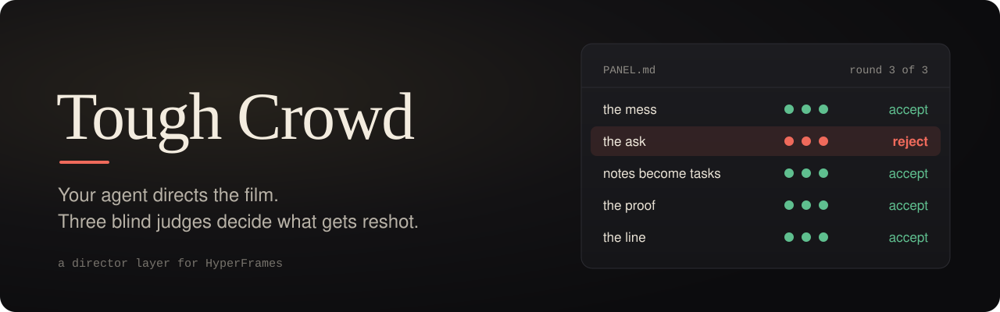
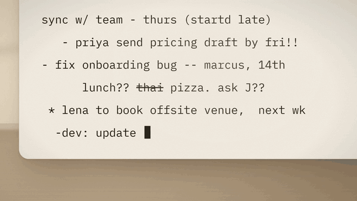
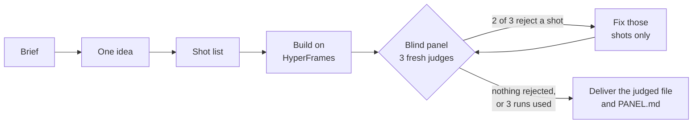
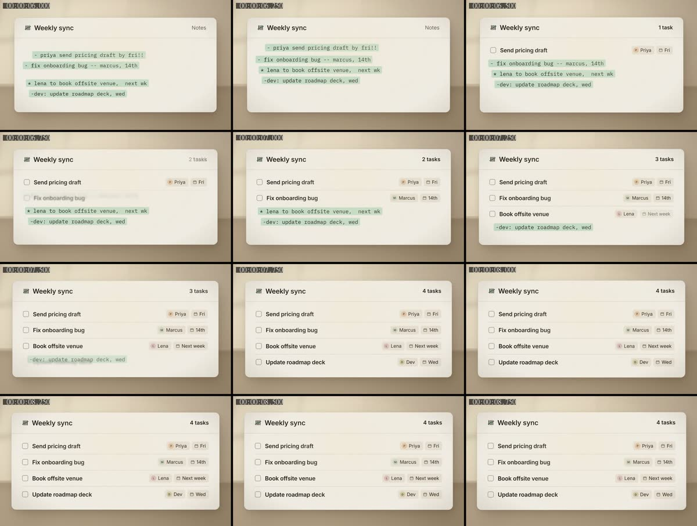

<p align="center">
  
</p>

<p align="center">
  <a href="LICENSE"></a>
  
  
  <a href="https://hyperframes.heygen.com"></a>
  
  
</p>

<p align="center">
  <a href="#quick-start">Quick start</a> ·
  <a href="#how-it-works">How it works</a> ·
  <a href="#what-the-judges-see">What the judges see</a> ·
  <a href="#does-it-work">Does it work?</a> ·
  <a href="#the-tool">The tool</a> ·
  <a href="#limits">Limits</a>
</p>

---

Coding agents can already render video. What they make tends to look like slides: a centred
card, even pacing, no camera, and an agent that marks its own work as finished.

**Tough Crowd** is a plugin that fixes the second half of that. It makes the agent direct a
product film shot by shot on [HyperFrames](https://hyperframes.heygen.com), then puts the film
in front of three judges who have never seen the code, the conversation or each other. Any shot
two of them reject goes back to be fixed.

<p align="center">
  
</p>

<p align="center"><sub>
  A 15-second film for Tally, a product that does not exist, directed and built by a coding agent.<br>
  This is the cut after three panel runs. The judges still reject its second shot, and the agent had to say so on delivery.
</sub></p>

## Why

- **Agents are generous critics of their own work.** A fresh judge with only the brief and the
  frames is not.
- **One judge is noisy.** Three judges and a majority are steadier.
- **"Make it better" is not a note.** Judges must give a time, a place in the frame, the problem
  and the change, so the agent has something exact to fix.
- **A film that was changed after judging was never judged.** The tool checks the delivered file
  against the one the panel saw.

## Quick start

You need Node 22 or newer, FFmpeg 5.1 or newer, the HyperFrames skills (`npx hyperframes skills`)
and a harness that can start subagents. Claude Code can.

Install it from inside Claude Code:

```
/plugin install tough-crowd --marketplace Reuben-Alex/tough-crowd
```

Or clone this repository and load it from the folder:

```
claude --plugin-dir /path/to/tough-crowd
```

Then ask for a film:

```
/tough-crowd:direct Make a 15-second launch film for our notes app. Warm, quiet, no voice-over.
```

You get the film, a `PANEL.md` with every judge's verdict on every shot, and a delivery note
that leads with anything the panel still rejects.

<details>
<summary>FFmpeg is installed but not found</summary>

Set `FFMPEG_PATH` and `FFPROBE_PATH` to the two executables. The tool uses those before it looks
on `PATH`.
</details>

<details>
<summary>Using another harness</summary>

Point the harness at `skills/direct/` and run the tool with
`node /path/to/tough-crowd/bin/tough-crowd.mjs`. The panel needs a way to start fresh agents that
share no context with the author.
</details>

## How it works



| Step | What happens |
| --- | --- |
| 0. Brief | The request is saved word for word as `BRIEF.md`. The judges read this, not the agent's summary of it |
| 1. Source | A public product is captured with HyperFrames, not redrawn from memory |
| 2. One idea | One sentence: the single thing the viewer watches change |
| 3. Direction | `DIRECTION.md` holds the shots. Each one names its hero, its share of the frame, the hold, and what causes the next move |
| 4. Stage and type | One of three stage presets and three type pairings, all from fonts HyperFrames already bundles |
| 5. Build | With the HyperFrames skill. Every object has its own pose in every shot |
| 6. Stock check | `npx hyperframes check` passes |
| 7. Panel | Three fresh judges, three runs at most. See below |
| 8. Deliver | The judged file, `PANEL.md`, and a note that leads with anything still rejected |

### The house rules

1. **Judges are blind.** Each is a new agent given one brief and a folder of frames. No code, no
   conversation, no earlier rounds, no other judge's answer.
2. **Majority rejects.** A shot two of three judges reject is rejected.
3. **Three runs at most,** with new judges every time. Only rejected shots force another run.
4. **Fix what was rejected.** Accepted shots are left alone.
5. **The delivered file is the judged file.** `verify` compares checksums and refuses a film the
   panel did not see.
6. **Rejections are said out loud.** After the third run a film may be delivered with open
   rejections, and the delivery note must lead with them.

## What the judges see

Not the video. Each judge gets time-stamped frame sheets at four frames a second, plus closer
strips across every shot change:

<p align="center">
  
</p>

And this is the kind of note that comes back. It is a real one, from the film above:

> **P0** · 2.5 to 4.8 s · whole frame.
> The bottom 35 to 40% of the frame is dead stage for 2.3 s. The "lunch?? thai pizza" line sits
> about 40 px from the top edge in soft focus, so the one non-task line is the most prominent
> note above the prompt.
> **Change:** reframe so the prompt bar sits on the lower third, with four or five full note
> lines above it and a clean margin of at least 90 px at the top.

`tally` turns the three answers into one `PANEL.md`:

```
# Panel result: round 3 of 3
**Rejected shots: 1 of 5.**
**Reaches the bar: no** (0 of 3 judges).
**Not judged: motion at speed, and sound.**
```

## Does it work?

One trial so far, out of five planned. The full record is in [`bench/results.md`](bench/results.md).

The same brief went to two agents: one with the stock HyperFrames skills, one with Tough Crowd.
Three new judges then compared the two films under neutral names.

| | Result |
| --- | --- |
| Blind comparison | Tough Crowd film preferred by 3 of 3 judges, each "clearly" |
| The project owner, also blind | Preferred the Tough Crowd film |
| Tough Crowd won | Composition, payoff, stage, typography and rhythm (3 of 3), story (2 of 3) |
| Stock won | UI credibility and the ending (3 of 3) |
| Rejected shots across its own three panel runs | 2, then 1, then 1 |
| Judges who saw it on its own and said it reaches the bar, a top-tier studio launch film | 0 of 9 |

What that does and does not show:

- **The loop moved the film.** Both shots rejected in the first run were accepted from the
  second run on.
- **It did not reach the bar.** The panel preferred it to the stock film and still said it was
  not there.
- **This trial is not proof the skill transfers.** At the time, the skill's worked example used
  the same product as this brief. The example has since moved to a product outside the test
  set. Four more briefs on other products decide whether the project continues, and that rule
  is written down in [`bench/PROCEDURE.md`](bench/PROCEDURE.md).

## The tool

```
tough-crowd packet <film> --brief BRIEF.md --direction DIRECTION.md [--round <n>] [--silent] [--refs <dir>]
tough-crowd packet <film> --ab <other film> --brief BRIEF.md [--silent]
tough-crowd tally <packet folder> [--panel-out <file>]
tough-crowd verify <film> [--panel <PANEL.md>]
```

| Command | Does | Exit code |
| --- | --- | --- |
| `packet` | Writes the judges' brief and time-stamped frame sheets under `.director/panel/`. With `--ab`, two films under neutral names | 0, or 2 on bad input |
| `tally` | Reads the three answers and writes `PANEL.md` | 0 nothing rejected, 1 a shot is rejected, 2 on bad or missing answers |
| `verify` | Confirms the file is the one judged and prints what the delivery note must lead with | 0, or 2 if it is not the judged file |

Run the commands from the film's project folder: `packet` writes under `.director/` there, and
`tally` and `verify` use the `PANEL.md` there. `--refs <dir>` shows the judges reference frames
you supply as examples of the look you want. `skills/direct/references/panel.md` has the full
procedure.

The package is not on npm yet. Run it with `node bin/tough-crowd.mjs`.

## What it is not

It does not render, capture, generate voice or music, or replace HyperFrames. HyperFrames does
all of that. Tough Crowd is the director and the screening room, nothing else.

## Limits

- **Judges see stills.** They cannot judge motion at speed or sound, and every `PANEL.md` says so.
  A person watching the film is still the only check on how it feels.
- **Judges are noisy.** Three judges and a majority reduce that; they do not remove it.
- **It costs more.** In the trial each panel run used about 260k tokens (three judges at about
  87k each). The fully judged film came to about 1.25 million tokens, against about 284k for the
  stock build.
- **Films up to about 30 seconds**, landscape. Longer films are not what the panel is tuned for.
- **Public products only** for capture. Logged-in screens have to be supplied by the person.

## What's inside

```
skills/direct/        the directing skill: the pass, staging rules, stage and type presets
bin/, src/            the tool: packet, tally, verify
templates/            the briefs the judges read
examples/stages/      a HyperFrames project showing the three stage presets
bench/                five test briefs, the procedure, and the results
docs/superpowers/     the design and the build plan
```

## Roadmap

- Run the four remaining test briefs.
- Stronger staging rules for camera movement, and stage presets with more depth.
- Publish to npm.

## Development

```
node --test
```

The tests need FFmpeg. `examples/stages/` is a HyperFrames project showing the three stage
presets; check it with `npx hyperframes check` from that folder.

## Licence

Apache-2.0. HyperFrames is a separate project by HeyGen, also Apache-2.0. Tough Crowd is not
affiliated with or endorsed by HeyGen or Anthropic.
